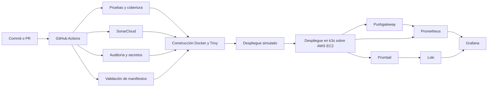

# Observabilidad, métricas y cumplimiento — Order Manager (EV3)

Este documento describe cómo se integran la observabilidad y las políticas de cumplimiento en el proyecto, y registra los resultados que observamos durante la ejecución en AWS.

## 1. Vista general



El job `deploy-k8s` se ejecuta en `main` cuando está habilitada la variable `K8S_DEPLOY_ENABLED` y el environment `aws-k3s` dispone del secret `KUBE_CONFIG_B64`.

## 2. Herramientas y dónde se integran

| Herramienta | Función | Ubicación o configuración | Etapa |
|---|---|---|---|
| Micrometer y Spring Actuator | Publican métricas HTTP, JVM y de negocio en `/actuator/prometheus`. | `pom.xml`, `src/main/java/com/example/ordermanager/observability/OrderMetrics.java`, `application.properties` | El smoke test consulta el endpoint. |
| Logs JSON y `requestId` | La aplicación registra eventos estructurados para facilitar su búsqueda y correlación. | `RequestLoggingFilter.java`, `application-docker.properties` | Ejecución de la aplicación. |
| Prometheus | Recoge métricas cada 15 segundos y conserva 3 días de datos. | `observability/helm-values/kube-prometheus-stack.yaml`, `observability/manifests/servicemonitor.yaml` | El `ServiceMonitor` define cómo consultar la API. |
| kube-state-metrics, node-exporter y cAdvisor | Recogen datos del clúster, los nodos y los contenedores, como CPU, memoria, reinicios y réplicas. | Incluidos en `kube-prometheus-stack` | Ejecución del clúster. |
| Loki y Promtail | Promtail recoge logs de los pods y Loki permite consultarlos desde Grafana. | `observability/helm-values/loki-stack.yaml` | Ejecución del clúster. |
| Pushgateway | Recibe métricas del pipeline, como duración del despliegue, cobertura y pruebas. | `scripts/push-ci-metrics.sh`, `observability/helm-values/pushgateway.yaml` | Último paso de `deploy-k8s`. |
| Grafana | Muestra métricas de aplicación, clúster y pipeline, además de logs de Loki. | `observability/manifests/order-manager-dashboard.json` | El dashboard se carga desde un ConfigMap. |
| PrometheusRule | Define las ocho alertas de Order Manager. | `observability/manifests/prometheusrule.yaml` | Se aplica durante `deploy-k8s`. |
| JaCoCo | Calcula la cobertura de líneas y hace fallar las pruebas si no se alcanza el mínimo de 75 %. | `pom.xml` | Job `test`. |
| SonarCloud | Ejecuta análisis estático y comprueba el Quality Gate. | `sonar-project.properties`, job `sonar` | Job `sonar`. |
| Trivy | Busca vulnerabilidades altas o críticas en la imagen y secretos en los archivos del repositorio. | Jobs `build` y `compliance` | Construcción y auditoría. |
| `audit-compliance.sh` | Comprueba 16 políticas de contenedores, Kubernetes, secretos, calidad, pipeline y observabilidad. | `scripts/audit-compliance.sh` | Job `compliance`. |
| Protección de `main` | Hay un script disponible para exigir checks antes de integrar cambios. | `scripts/setup-branch-protection.sh` | **Pendiente de configurar y verificar en GitHub.** |

El Alertmanager está deshabilitado en la configuración de Helm. Las reglas se evalúan y se pueden consultar en Prometheus/Grafana; no se han configurado notificaciones externas.

Durante la instalación, Helm mostró una advertencia de que el chart `loki-stack` está obsoleto. Loki y Promtail quedaron desplegados y los logs de la API aparecieron en Grafana.

## 3. Métricas del dashboard

| Panel | Consulta representativa | Resultado observado |
|---|---|---|
| Pods disponibles | `sum(up{namespace="order-manager",service="order-manager"})` | 2 pods disponibles. |
| Errores HTTP 5xx | Proporción de respuestas 5xx durante los últimos 5 minutos. | 0,00 % en la captura. |
| Reinicios de pods | `sum(increase(kube_pod_container_status_restarts_total{namespace="order-manager",container="order-manager"}[1h]))` | 0 en la captura. |
| Pedidos creados en el rango | `sum(increase(orders_created_total{namespace="order-manager"}[$__range]))` | El panel mostró “No data” en la captura. |
| Transiciones rechazadas | `sum(increase(orders_invalid_transition_total{namespace="order-manager"}[$__range]))` | 2 en la captura. |
| Commit desplegado | `ci_deploy_info{job="order-manager-ci"}` | La captura mostró el commit `a26a30e`. |
| Duración del despliegue | `ci_deploy_duration_seconds{job="order-manager-ci"}` | Aproximadamente 1 minuto en la captura. |
| Cobertura de pruebas | `ci_test_coverage_ratio{job="order-manager-ci"}` | 97,5 % en el dashboard; el reporte JaCoCo registra 97,54 %. |
| Pruebas ejecutadas y fallidas | `ci_tests_total` y `ci_tests_failed_total` | 79 ejecutadas y 0 fallidas en la captura. |
| Peticiones HTTP | `rate(http_server_requests_seconds_count{namespace="order-manager"}[1m])` | Se observaron peticiones en el periodo de la captura. |
| Latencia p95/p99 | `histogram_quantile(...)` sobre las métricas HTTP | Se observó actividad en el periodo de la captura. |
| CPU y memoria por pod | `container_cpu_usage_seconds_total` y `container_memory_working_set_bytes` | El dashboard mostró series para los pods de Order Manager. |
| Logs de error y advertencia | Consultas Loki filtradas por nivel `ERROR` y `WARN`. | Los paneles no mostraron datos en la captura. |
| Todos los logs de la API | `{namespace="order-manager",app="order-manager"}` | Se observaron logs JSON de nivel `INFO`. |

Los resultados anteriores corresponden a las capturas de esta ejecución y pueden cambiar en ejecuciones posteriores. El panel de pedidos creados requiere una revisión adicional, porque no mostró datos.

## 4. Alertas configuradas y observaciones del equipo

Estas son las condiciones configuradas en `observability/manifests/prometheusrule.yaml` y las acciones descritas en sus anotaciones:

| Alerta | Condición configurada | Acción descrita en la regla |
|---|---|---|
| `OrderManagerDown` | No hay pods scrapeables durante 1 minuto. | Revisar pods y logs; si coincide con un despliegue, evaluar rollback. |
| `OrderManagerPodRestarts` | Más de 2 reinicios en 15 minutos, durante 1 minuto. | Revisar `OOMKilled` y fallas de liveness; evaluar el límite de memoria. |
| `OrderManagerHighErrorRate` | Más de 5 % de respuestas 5xx durante 5 minutos. | Buscar la excepción por `requestId` en Loki y evaluar rollback o hotfix. |
| `OrderManagerHighLatency` | Latencia p95 superior a 500 ms durante 5 minutos. | Revisar CPU y conexiones de base de datos; comprobar el escalado del HPA. |
| `OrderManagerHighMemory` | Uso de memoria superior al 85 % del límite durante 10 minutos. | Revisar límites y posible consumo excesivo de memoria. |
| `OrderManagerHighCPU` | Uso de CPU superior al 85 % del límite durante 10 minutos. | Revisar el máximo de réplicas del HPA y los límites de CPU. |
| `OrderManagerLowTestCoverage` | Cobertura inferior al 75 % durante 1 minuto. | Revisar la política de cobertura, que también se aplica en JaCoCo. |
| `OrderManagerSlowDeploy` | Despliegue superior a 420 segundos durante 1 minuto. | Revisar probes, descarga de imagen y recursos del nodo. |

El panel de transiciones rechazadas muestra una métrica, pero **no hay una alerta configurada con un umbral para esa señal**.

En nuestras capturas vimos dos pods disponibles, 0,00 % de errores 5xx, cero reinicios, 79 pruebas y 97,5 % de cobertura. El panel de pedidos creados mostró “No data”.

Aprendimos a visualizar mejor el proyecto y observar sus métricas. Si aumentan los errores, analizaremos el código para identificar la causa. Si sube el uso de CPU o memoria, revisaremos el consumo de recursos y si los límites que configuramos quedaron demasiado bajos.

## 5. Políticas de cumplimiento (IE5)

| Mecanismo | Política comprobada | Evidencia |
|---|---|---|
| `audit-compliance.sh` C1–C3 | Imagen sin root, imagen base con versión fija y `HEALTHCHECK`. | Job `compliance` y artefacto `reporte-auditoria`. |
| `audit-compliance.sh` K1–K2 | Deployment endurecido y sin etiqueta `:latest`. | Job `compliance`. |
| `audit-compliance.sh` S1–S2 | Sin credenciales en texto plano; `.env` no versionado. | Job `compliance` y escaneo de secretos con Trivy. |
| `audit-compliance.sh` Q1–Q2 | Cobertura mínima de 75 % y Quality Gate. | Jobs `compliance`, `test` y `sonar`. |
| `audit-compliance.sh` P1–P3 | Permisos mínimos, Trivy fijado por SHA y Dependabot. | Job `compliance` y configuración del repositorio. |
| `audit-compliance.sh` O1–O4 | Archivos requeridos de observabilidad presentes en el repositorio. | Job `compliance`. |
| SonarCloud | Análisis estático y Quality Gate. | Job `SonarCloud (Quality Gate)`. |
| Protección de `main` | El repositorio incluye un script para configurar checks requeridos. | **La protección aún está pendiente de aplicar y verificar.** |

El reporte de auditoría se publica como artefacto `reporte-auditoria` durante 90 días.

## 6. Detención del pipeline ante fallas críticas (IE6)

| Falla | Job que la detecta | Efecto definido en el pipeline |
|---|---|---|
| Pruebas fallidas o cobertura menor al 75 % | `test` (JaCoCo) | No se ejecutan `build` ni los despliegues. |
| Quality Gate rechazado | `sonar` | No se ejecutan `build` ni los despliegues. |
| Credencial en texto plano, root o umbral debilitado | `compliance` | No se ejecutan `build` ni los despliegues. |
| Vulnerabilidad HIGH/CRITICAL con parche | Trivy en `build` | La imagen no se publica. |
| Manifiestos inválidos | `k8s-validate` | El build no continúa. |
| Falla de despliegue o smoke test en Kubernetes | `deploy-k8s` | Se intenta el rollback automático de Order Manager. |
| Falla de un workflow iniciado por `push` | `alert` | Se abre o actualiza un Issue de GitHub. |

Para demostrar las fallas críticas, el proyecto incluye:

```bash
bash scripts/demo-falla.sh secreto
bash scripts/demo-falla.sh test-fallido
```

Cada comando crea una rama de demostración. Se debe abrir un PR hacia `main` y guardar evidencia de que los checks fallan y que el build/despliegue queda omitido. Ver `docs/evidencia-ev3.md`.
